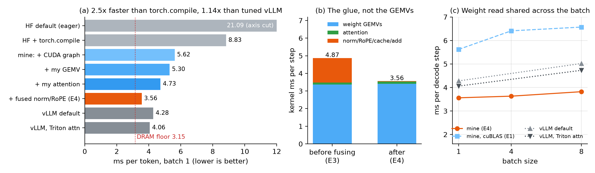
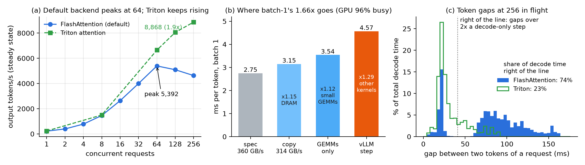

# LLM decode on one 12 GB GPU: profiling vLLM, then Triton kernels

Decoding one token of Qwen2.5-0.5B (BF16) reads all 0.99 GB of weights, so on an RTX 3060 a step cannot take less
than 2.75 ms (3.15 ms at the 314 GB/s a plain device copy reaches). vLLM 0.32.0 took 4.57 ms. Part 1 finds where the
rest goes inside vLLM; Part 2 replaces the decode step with Triton kernels and measures how close it gets to the
bandwidth floor.

Results: [RESULTS.md](RESULTS.md) (Part 1) and [kernels/RESULTS.md](kernels/RESULTS.md) (Part 2). Plans fixed
before running, with change logs: [DESIGN.md](DESIGN.md), [kernels/DESIGN.md](kernels/DESIGN.md).

## Result



Batch 1, 512-token prompt, greedy, 256 generated tokens.

| Path | ms / token, batch 1 | batch 8 |
|---|---:|---:|
| HF Transformers eager | 21.09 | — |
| HF static cache + `torch.compile` | 8.83 | — |
| E1: engine in torch ops + one CUDA graph per step | 5.62 | 6.57 |
| E2: + Triton GEMV | 5.30 | — |
| E3: + Triton flash-decoding attention | 4.73 | — |
| **E4: + fused RMSNorm / residual / RoPE + KV write** | **3.56** | **3.82** |
| vLLM 0.32.0 offline, default (FlashAttention) | 4.28 | 5.02 |
| vLLM 0.32.0 offline, Triton attention | 4.06 | 4.73 |

- E4 is 2.5× faster than `torch.compile` and 1.14× (batch 1) / 1.24× (batch 8) faster than vLLM with Triton attention.
- E4's weight GEMVs run at 290 GB/s, 92% of the measured copy bandwidth; its step is 1.09× the 3.15 ms floor.
- (b) Before fusing, about 950 small kernels for RMSNorm, RoPE, KV writes, casts and residual adds took 1.39 ms per
  step (29%). The plan had expected the remaining time in GEMVs and attention. Fusing RMSNorm into the GEMV
  prologue, the residual add into its epilogue, and RoPE with the KV write leaves 7 kernels per layer.
- (c) From batch 1 to 8 the E4 step grows 7%, because the weight read is shared across the batch.

## Part 1: diagnosing vLLM



- Setup: vLLM pinned by image digest in Docker; a Poisson / closed-loop load generator that records every streamed
  token (`sl/`); a mock server shows the client sustains 100 req/s. A session is discarded if batch-1 latency drifts
  more than 5%.
- (b) torch profiler, 100 steps: the GPU is busy 96% of each step, so CPU overhead is not the cause. cuBLAS runs the
  small qkv / o / down matrices at 140–220 GB/s, and attention costs 0.43 ms per step.
- (a, c) Past 64 concurrent requests throughput falls. Steps that also carry a new request's prefill take 4–5× longer
  in FlashAttention's split-KV kernel. With Triton attention throughput rises 1.9× at 256 requests.

## Part 2: the decode path (`kernels/`)

- `engine.py`: Qwen2 forward with fused weights and a static KV cache, captured as one CUDA graph per decode step.
- `tkernels.py`:
  - GEMV: each program streams its rows of the weight matrix once. One input row runs on CUDA cores; 2–8 rows are
    padded to 16 and use tensor cores. gate and up are computed together with SiLU·mul.
  - Flash-decoding attention: each program reads one KV head once for the 7 query heads that share it (GQA), and
    keys are split across programs. 0.12 ms per step vs 0.43 ms in vLLM.
  - RoPE + KV-cache write in one kernel.
- `check.py`: kernels vs torch on the real shapes (max abs error ≤ 0.016, about one BF16 ulp), and greedy tokens vs
  HF eager.

Limits: decode step only. There is no scheduler, continuous batching, paged KV cache or sampling beyond argmax, and
batch ≤ 8. vLLM does all of that, so E4 vs vLLM compares the decode step, not a serving system.

## Reproduce

```bash
# Part 2, inside the pinned vllm/vllm-openai:v0.32.0 image
./kernels/run.sh check.py
./kernels/run.sh bench.py
./kernels/run.sh vllm_ref.py
./kernels/run.sh profile_step.py

# Part 1 (needs Docker; sg docker if your user is not in the group)
uv sync
uv run python scripts/f0.py F0-r2                                    # vLLM server + closed-loop sweep, 1–256 in flight
uv run python scripts/f0.py F0-triton --attention-backend TRITON_ATTN
uv run python scripts/profile_decode.py run                          # torch profiler traces at 1, 64, 256 in flight
uv run python scripts/profile_decode.py analyze
```

Per-request logs and profiler traces are not committed (about 1.3 GB); `runs/` keeps the metrics and tables.

Hardware: RTX 3060 12 GB under WSL2, i5-12400. Close other GPU applications before running; the drift check cannot
see them.
